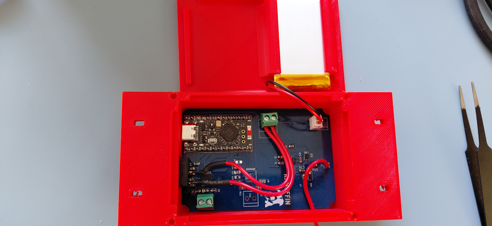
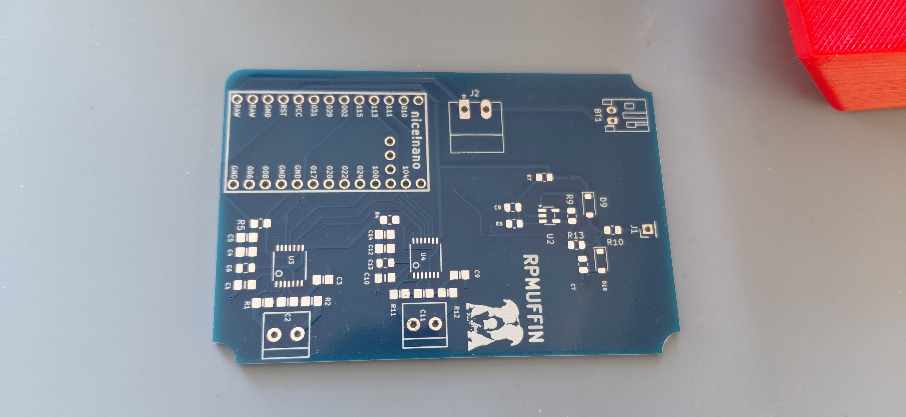
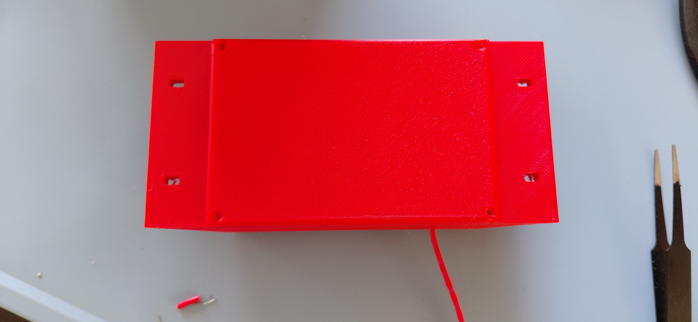

# Engine Meter (RPMuffin)

A small, battery-powered engine monitor for a paramotor. It measures **RPM**, **CHT** and **EGT**, and sends them over **Bluetooth LE** as NMEA-style sentences to [Gaggle](https://www.gaggle.aero/) or the `paraglide_vario_ESP32` flight computer. It also reports its own battery percentage.

It was designed and tested on a **Moster 185** (single-cylinder two-stroke), but it should work on any engine with a spark-ignition lead and a thermocouple-instrumented head or exhaust.

| | |
|---|---|
| **MCU** | nice!nano (nRF52840) |
| **RPM** | Inductive pickup (2 wraps on the HT lead) → LMV331 comparator → interrupt |
| **Temperature** | 2 × MAX31856 thermocouple amplifiers (CHT + EGT), K-type as shipped |
| **Radio** | BLE, Nordic UART Service, advertises as `ParaEngineMeter` |
| **Update rate** | 5 Hz |
| **Power** | 1000 mAh single-cell LiPo, JST-PH 2.0 mm, charged over USB-C |
| **PCB** | 2 layers, 1.6 mm, about 50.6 × 75.1 mm |
| **Case** | 3D printed (PLA), about 58.5 × 123.5 × 27 mm including mounting tabs |



---

## Repository layout

| Path | Contents |
|---|---|
| `Engine_meter/` | PlatformIO firmware project (open **this** folder in VS Code) |
| `Engine_meter/src/` | `main.cpp` (RPM, thermocouples, BLE) and `AuxSensors.cpp/.h` (battery gauge) |
| `Engine_meter/boards/` | Custom `nicenano` board definition and pin variant for PlatformIO |
| `Engine_monitor_V1/` | KiCad 10 project: schematic and PCB |
| `Engine_monitor_V1/Gerber files/` | Fabrication outputs: Gerbers, drill files, JLCPCB BOM, JLCPCB CPL, and `Engine_monitor_V1_order.zip` |
| `3D print files/` | Case and lid as STL, plus ready-sliced G-code for a Prusa MK3S |
| `Photos/` | Photos of the bare PCB and the finished unit |

---

## 1. Parts list

### Parts on the PCB (SMD, 0805 unless noted)

These are the parts in `Engine_monitor_V1_BOM_JLCPCB.xlsx`, and they can be assembled by JLCPCB.

| Qty | Value | Designators | Notes |
|---|---|---|---|
| 4 | 10 nF 50 V X7R | C1, C3, C9, C10 | Thermocouple input filtering |
| 7 | 100 nF 50 V X7R | C2, C4, C5, C8, C11, C12, C14 | Decoupling; C8 filters the comparator reference |
| 2 | 10 µF 25 V X5R | C6, C13 | 3.3 V bulk decoupling |
| 4 | 100 Ω 1 % | R1, R2, R11, R12 | Thermocouple input series resistors |
| 5 | 10 kΩ 1 % | R4, R5, R7, R8, R9 | R4/R5 chip-select pull-ups, R7/R8 comparator reference divider, R9 comparator output pull-up |
| 1 | **150 kΩ** 1 % | R10 | RPM input series resistor. See the note below |
| 1 | 1 MΩ 1 % | R13 | Comparator hysteresis (positive feedback) |
| 1 | 220 kΩ 1 % | R14 | RPM input divider to GND |
| 2 | 1N5819HW-7-F Schottky, SOD-123 | D9, D10 | RPM input clamps (to 3.3 V and to GND) |
| 1 | LMV331IDBVR, SOT-23-5 | U2 | Single comparator |
| 2 | MAX31856MUD+, TSSOP-14 | U3, U4 | U3 = **CHT**, U4 = **EGT** |

> **R10 value:** the production design uses **150 kΩ**. It was originally 22 kΩ, which was too sensitive to pick up noise on the ignition lead, so it was increased. Use 150 kΩ.
>
> **D9/D10 in the JLCPCB BOM** are marked "consigned" (you supply them). Either supply 1N5819HW-7-F parts yourself, or pick an in-stock SOD-123 Schottky at order time.

### Parts you add by hand (through-hole / modules)

| Ref | Part | Purpose |
|---|---|---|
| U1 | **nice!nano** (v2 or compatible, nRF52840), 2 × 12-pin headers or castellated solder | MCU, BLE radio, LiPo charger |
| BT1 | JST-PH 2.0 mm 2-pin horizontal header (S2B-PH-K) | Battery connector |
| J2 | 2-pin screw terminal, 3.81 mm pitch (Phoenix MC 1,5/2-G-3.81 footprint) | **Power switch** (in series with the battery) |
| X1 | 2-pin screw terminal, 3.5 mm pitch | **CHT** thermocouple input |
| X2 | 2-pin screw terminal, 3.5 mm pitch | **EGT** thermocouple input |
| J1 | 1-pin 2.54 mm header (or a wire soldered straight in) | RPM pickup input |

### Other items

- **Battery:** 1000 mAh single-cell LiPo with a **2 mm JST-PH** connector (ideally with a built-in protection circuit).
- **Power switch:** any small SPST switch rated for a few hundred mA, wired to J2.
- **Thermocouples:** two K-type probes, one for CHT (for example a spark-plug washer or bolt-on type) and one for EGT (exhaust probe). Use proper thermocouple wire or a compensated extension.
- **RPM pickup wire:** a short length of insulated hookup wire.
- **Fasteners:** 4 small self-tapping screws for the lid (see section 5), plus zip ties or straps for mounting.
- USB-C cable for programming and charging.

---

## 2. Order and build the PCB

1. Go to JLCPCB and upload `Engine_monitor_V1/Gerber files/Engine_monitor_V1_order.zip`.
2. Settings: **2 layers, 1.6 mm** thickness. The board is about 50.6 × 75.1 mm.
3. **Bare board:** order the PCB only and hand-solder everything.
4. **Assembled:** tick *PCB Assembly*, then upload `Engine_monitor_V1_BOM_JLCPCB.xlsx` and `Engine_monitor_V1_CPL_JLCPCB.csv`. The BOM has no LCSC part numbers, so match each line to a stocked part in the JLCPCB parts picker (see the part table above). Only the SMD parts on the top side are assembled. You add the nice!nano, terminals, header and JST connector yourself.



### Hand-soldering order (if building from a bare board)

The two MAX31856 chips are TSSOP-14, so the SMD parts are best done with flux, a fine tip and a magnifier.

1. U2, U3, U4 (the ICs). Check pin 1 orientation against the silkscreen.
2. The 0805 resistors and capacitors, then the two diodes D9/D10 (check the stripe against the silkscreen).
3. Terminal blocks X1, X2, J2 and the JST connector BT1.
4. J1.
5. Finally the nice!nano. Either solder header pins or solder it directly. Keep the USB-C end of the board towards the board edge as shown in the silkscreen.

---

## 3. How the hardware works

### Pin map

The firmware uses software (bit-banged) SPI, so the two MAX31856s share one bus with separate chip-selects.

| Signal | nice!nano GPIO | Firmware pin number |
|---|---|---|
| MAX31856 SDO → MCU (MISO) | P1.00 | 32 |
| MAX31856 SDI ← MCU (MOSI) | P1.13 | 45 |
| SCK | P1.15 | 47 |
| CS for **CHT** (U3) | P0.11 | 11 |
| CS for **EGT** (U4) | P1.04 | 36 |
| RPM comparator output | P1.11 | 43 |

Pin numbers follow the Adafruit nRF52 core convention: P0.xx → xx, P1.xx → 32 + xx.

### RPM input

- The pickup wire goes to **J1**. It passes through **R10 (150 kΩ)** into a divider with **R14 (220 kΩ)**, giving roughly 0.6 × the input voltage. **D10** clamps to GND and **D9** clamps to 3.3 V to protect the comparator.
- **U2 (LMV331)** compares that signal with a **1.65 V** reference made by R7/R8 and filtered by C8. As a rough guide, the pickup needs to swing above about **2.8 V** at J1 to trigger.
- **R13 (1 MΩ)** feeds the output back to the input for hysteresis. **R9 (10 kΩ)** pulls the open-collector output up to 3.3 V.
- The nRF52840 counts the rising edges on an interrupt.

### Thermocouple input

Each channel copies the Adafruit MAX31856 breakout design: 100 Ω series resistors on the thermocouple inputs, 10 nF / 100 nF filtering, and a 10 kΩ pull-up on each chip-select. **X1 = CHT (U3)** and **X2 = EGT (U4)**.

Polarity matters. If a reading falls when you warm the probe, swap the two wires. The firmware sets **type K** for both channels, but the MAX31856 supports B, E, J, K, N, R, S and T. To change it, edit the two `setThermocoupleType(...)` lines in `setup()` in `Engine_meter/src/main.cpp`.

### Power

- The battery connects to **BT1**. BT1 pin 1 is battery **+** and pin 2 is **GND**.
- **BT1 + goes to J2 (the switch), and the other side of the switch goes to the nice!nano's battery-in pin** (pin 26, marked BATIN/RAW on the board). So the battery is only connected to the nice!nano while the switch is **on**. Charge with the switch on.
- Charging happens through the nice!nano's USB-C port. It charges at roughly **100 mA**, so a flat 1000 mAh pack takes about **10 hours**.
- The nice!nano's regulator provides the 3.3 V rail for the comparator and both MAX31856s.

> ⚠️ **Check battery polarity before the first power-up.** JST-PH LiPo packs from different suppliers are wired in different orders, and a reversed pack can destroy the nice!nano. Use a multimeter on the pack connector, and compare it with BT1 (pin 1 = +, pin 2 = GND) on the PCB. If it is reversed, re-pin the connector on the battery lead.

---

## 4. Firmware

The firmware is a PlatformIO project in `Engine_meter/`.

### Build and upload

1. Install [VS Code](https://code.visualstudio.com/) and the **PlatformIO IDE** extension.
2. **File → Open Folder…** and choose the `Engine_meter` folder (not the repo root).
3. PlatformIO downloads the `nordicnrf52` platform and the libraries (Adafruit MAX31856, BusIO and TinyUSB) on first build.
4. Build, then upload with the nice!nano plugged in over USB-C. PlatformIO will try to reset it into the bootloader automatically. If the upload hangs, **double-tap the reset button** and upload again. The bootloader appears as its own COM port (`VID_239A&PID_00B3`), and the upload must target that port.
5. For debug output, open the running firmware's serial port at **115200 baud**. It prints a line every 200 ms with RPM, raw RPM, pulse and reject counts, EGT, CHT and battery %.

The `nicenano` board definition in `boards/` comes from [ICantMakeThings/Nicenano-NRF52-Supermini-PlatformIO-Support](https://github.com/ICantMakeThings/Nicenano-NRF52-Supermini-PlatformIO-Support) via [bertrik/nicenano-example](https://github.com/bertrik/nicenano-example).

### Settings you may want to change (`Engine_meter/src/main.cpp`)

| Setting | Default | Meaning |
|---|---|---|
| `PULSES_PER_REV` | `1.0` | Spark pulses per crank revolution. Correct for a single-cylinder two-stroke such as the Moster 185. If the reading is double or half what you expect, change this |
| `RPM_TIMEOUT_MS` | `1500` | No pulse for this long → RPM reports 0 |
| `RPM_WINDOW_MS` | `5000` | RPM averaging window |
| `RPM_FAST_ATTACK` / `RPM_FAST_WINDOW_MS` / `RPM_FAST_THRESHOLD` | `1` / `1000` / `0.10` | Use a 1 s window when it differs from the 5 s average by more than 10 % |
| `RPM_ROUND_TO` / `RPM_HYST` | `10` / `7.0` | Displayed RPM is rounded to 10 RPM with 7 RPM hysteresis |
| `RPM_MIN_LOCKOUT_US` | `5000` | Ignores edges closer together than this (ringing rejection). It adapts to 40 % of the last period above about 600 RPM |
| `SEND_PEMBAT` | `1` | Set to `0` to stop sending the proprietary battery sentence |
| `RPM_DEBUG_EDGES` | `0` | Set to `1` to print raw edge intervals when diagnosing pickup noise |

### BLE output

The device advertises as **`ParaEngineMeter`** and exposes the Nordic UART Service. Each message is an ASCII sentence with an XOR checksum and CRLF line ending.

```
$EMS,<pressure>,<fuelFlow>,<fuelRemaining>,<fuelUsed>,<ambientTemp>,<CHT>,<EGT>,<waterTemp>,<RPM>*HH
$PEMBAT,<percent>*HH
```

- Unused `EMS` fields are filled with `999999` (pressure), `9999` (fuel fields) or `99` (temperatures).
- **CHT and EGT** are in °C × 100, clamped to −300..1500 °C. A value of `99` means unavailable (sensor fault).
- **RPM** is sent × 100. `0` is a valid stopped-engine reading.
- **`$PEMBAT`** is battery percentage, 0–100, estimated from the nRF52840's internal supply-voltage ADC and a single-cell LiPo curve. It is approximate. It reads high while charging and sags under load.

Example: RPM 3100, CHT 180.0 °C, EGT 550.0 °C:

```
$EMS,999999,9999,9999,9999,99,18000,55000,99,310000*7C
```

**Gaggle:** add the meter under *Profile → Equipment → Bluetooth Devices*. Gaggle must receive a real supported reading within about 35 seconds.

**paraglide_vario_ESP32:** select `ParaEngineMeter` in the vario's Bluetooth scan list.

---

## 5. 3D printed case

The case and lid are in `3D print files/`.

| File | Print time (Prusa MK3S, 0.15 mm, PLA) |
|---|---|
| `Engine meter case.stl` | 5 h 18 min |
| `Engine meter lid.stl` | 1 h 44 min |

Ready-sliced G-code for a Prusa MK3S is included. For another printer, slice the STLs yourself, 0.15 mm layers in PLA or similar (PETG is a better choice for a hot, sunny harness).

- The **PCB sits in the case** and the **battery sits in the lid**, as in the photo above.
- The lid is held on by **4 small self-tapping screws** into the corner holes (the lid has pilot holes at about 2 mm).
- The **mounting tabs** on each side have slots (about 2.5 × 4.5 mm) for zip ties or straps.
- The case was designed in Onshape.



---

## 6. Wiring it to the engine

### RPM pickup

1. Take a length of insulated wire. Solder one end to **J1**.
2. Wrap the other end **2 turns around the ignition (HT) lead**, close to the spark plug cap. Do not connect it to anything else. The signal is picked up by coupling alone.
3. Secure the wrap with heat-shrink or tape, and keep the lead clear of the exhaust and moving parts.

If RPM is wrong: no reading means add a turn, and spurious readings mean remove a turn or move the wrap further from the plug. The `rejects` counter in the serial output shows how many noise edges are being filtered. The reading is also wrong if `PULSES_PER_REV` doesn't match your engine.

### Thermocouples

- **CHT probe → X1**, **EGT probe → X2**.
- Keep thermocouple wires away from the ignition lead and coil.

### Power

Connect a switch to **J2**, plug the battery into **BT1** (after checking polarity), and charge through the nice!nano's USB-C port.

---

## 7. First power-up checklist

1. Check the 3.3 V rail on the board with a meter before fitting the nice!nano (if you soldered it in a socket).
2. Plug the battery in, switch on, and confirm the nice!nano powers up.
3. Connect USB, open the serial monitor at 115200 baud, and confirm you see `[BOOT] Engine meter ready, advertising as ParaEngineMeter`.
4. With nothing connected, thermocouple channels will show a fault. With a probe attached you should see room temperature. Warm the probe and check that the reading rises.
5. Check the `BAT=` value is sensible for the pack voltage.
6. With the engine running, check the RPM against a known reference such as a handheld tachometer.
7. Connect from Gaggle or the vario (or a generic BLE app such as nRF Connect) and confirm `$EMS` sentences arrive.

---

## License

This project is open source under the **GNU General Public License v3.0**. See [`LICENSE`](LICENSE) for the full text. It covers the firmware, PCB design files, case models and documentation in this repository. You are free to build, modify and share it, and if you distribute a modified version you must release your changes under the same license.

Third-party files keep their own licenses and notices (see Credits below).

## Credits

- Thermocouple front end based on the [Adafruit MAX31856 breakout](https://www.adafruit.com/product/3263).
- nice!nano board support from ICantMakeThings and bertrik (linked above).
- Firmware uses the Adafruit nRF52 Arduino core (Bluefruit) and the Adafruit MAX31856 library.
